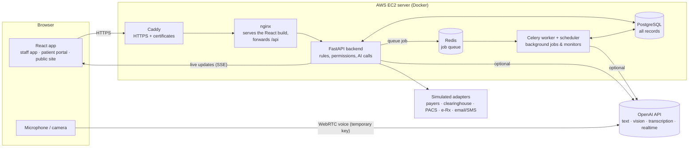
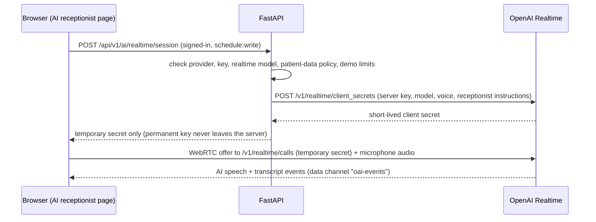
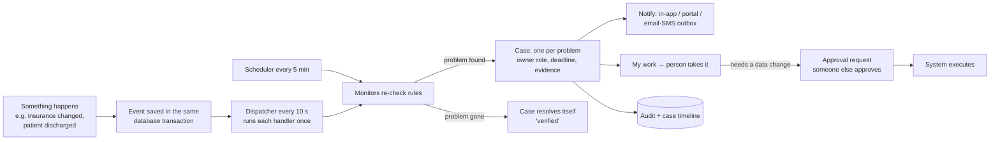
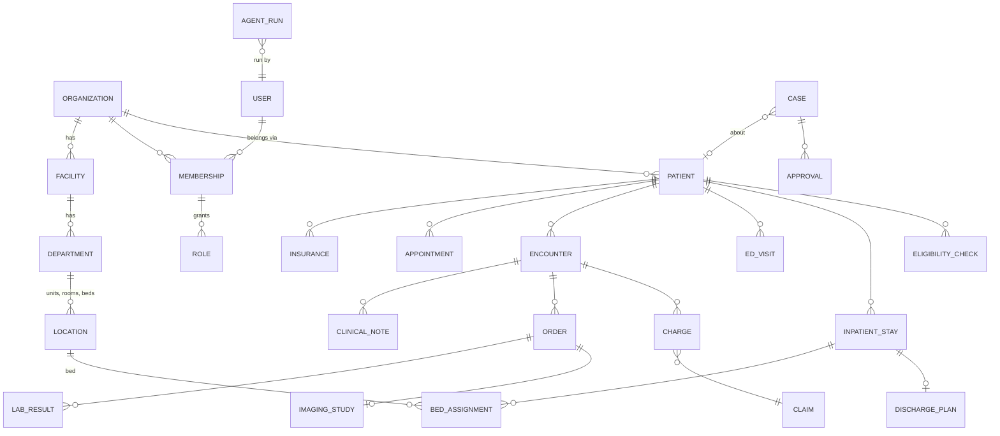

# Undeclared HMS — How the Whole System Works

_A plain-English guide to the application as it exists in this repository (branch `dev`, November 2026).
Everything here was checked against the source code, database models, tests and deployment files. Where something is
simulated or not yet verified against a real vendor, it says so._

---

## 1. What Undeclared HMS is

Undeclared HMS is a hospital management system: one web application that a hospital's staff and patients use for
almost everything that happens around care. A receptionist registers a patient and books a visit; a nurse records
vital signs; a doctor writes notes and orders tests; the laboratory, radiology and pharmacy process those orders; bed
managers place admitted patients; billing turns the care into insurance claims; and patients use a portal to book
visits, read results and pay bills.

The problem it tackles is **fragmentation**. In many hospitals these jobs live in separate systems that don't talk to
each other, so information is re-typed, phoned through or lost — an expiring insurance policy is noticed only when the
claim is denied, a discharge stalls because nobody told the pharmacy, or a critical lab value sits unread. Undeclared
puts every department on the **same patient record and the same database**, so a change in one place is immediately
visible everywhere it matters.

On top of that shared record it adds two kinds of help. **Automation**: background checks ("monitors") that spot
problems — coverage that looks inactive, stock about to expire, a discharge missing a step — and turn each one into a
task for the right team. And **AI assistance**: drafting visit notes, reading uploaded documents, summarising
operations, and a voice assistant. The AI only drafts, suggests or proposes; people review, approve and sign. The
system currently runs on **synthetic (made-up) data** as a demonstration; it is not certified for clinical use and is
not represented as HIPAA-compliant.

---

## 2. Overall architecture

### What each piece does

| Component | What it does | Everyday example |
|---|---|---|
| **React frontend** (`frontend/`) | The screens. Runs in the browser; asks the backend for data and sends user actions. | The bed board you click on. |
| **FastAPI backend** (`backend/app/`) | The rules: checks who you are and what you may do, validates input, reads/writes the database, calls AI. | Refuses to let a nurse approve her own stock-waste request. |
| **PostgreSQL** | The single database for every department. Also enforces some rules itself (see §7). | Stores the patient, the visit, the bed assignment and the claim. |
| **Redis + Celery** | A job queue and a background worker. Slow or scheduled work happens here so screens stay fast. | Reading an uploaded PDF; running the "expiring stock" check every 5 minutes. |
| **Scheduler (Celery beat)** | Starts recurring jobs: event dispatch (10 s), escalations (60 s), monitors (5 min), appointment reminders (15 min), demo clean-up (10 min). | Every 5 minutes it re-checks whether insurance problems are fixed. |
| **Live updates (SSE)** | The backend pushes "something changed" signals to open screens (`GET /api/v1/stream`, backed by PostgreSQL LISTEN/NOTIFY). | The Command Center tile updates when a patient is admitted. |
| **OpenAI** (optional) | Language, vision, transcription and realtime voice models. Used only when an administrator configures a key; otherwise features run in a labelled simulation. | Drafting a SOAP note from a recorded visit. |
| **Integration adapters** (`backend/app/integrations/adapters.py`) | One place per outside system (payer eligibility, claims clearinghouse, order transmission, imaging archive, messaging). **All are simulated today.** | "Check with payer" returns a simulated active/inactive answer. |
| **Notifications** (`backend/app/engine/notifications.py`) | In-app and portal notices are real; email/SMS go to a message **outbox** (simulated sending). | A reminder appears in Admin › Message outbox instead of a real phone. |
| **Caddy** | Front door: HTTPS certificate (Let's Encrypt), redirects HTTP→HTTPS. | Makes `https://3-19-143-26.sslip.io` secure. |
| **nginx** | Serves the built React files and forwards `/api` calls to FastAPI. | |
| **Docker on AWS EC2** | Packages each piece as a container on one server. | Six containers on a t3.small. |

**How data moves — an example.** A receptionist registers a patient: the React form sends the details to
`POST /api/v1/patients`. FastAPI checks the user's permission (`patients:write`), checks for possible duplicates, gives
the patient a record number, writes the row to PostgreSQL, writes an audit entry, and returns the new record. If the
patient has insurance, an "insurance changed" event is stored in the same database transaction; a moment later the
background dispatcher picks it up and Insurance Guardian re-checks coverage.

---

## 3. The hospital modules

Status legend: **Working** = implemented end-to-end with real database persistence and tests; **Simulated** = the
workflow is real but an outside connection is faked; **Partial** = limited scope noted.

| # | Module | Who uses it / where | What it does (practical example) | Backend & data | Connects to | Status |
|---|---|---|---|---|---|---|
| 1 | **Patient registration** | Front desk, nurses (`/patients`, ⌘K search) | Register "Maria Lopez"; warns if a similar record exists; edit demographics and insurance. | `patients.py` router + `services/patients.py`; tables `patients`, `patient_insurances` | Every module (all records hang off the patient) | Working |
| 2 | **Appointments & scheduling** | Front desk, clinicians (`/schedule`, `/front-desk`) | Book Dr Chen at 10:00; check in, room, check out; no-shows; reminders. | `scheduling.py`; `appointments` (database blocks double-booking a provider) | Portal booking, insurance readiness, follow-up monitor | Working (reminder delivery simulated) |
| 3 | **Electronic health record** | Doctors, nurses (`/patients/:id`) | Allergies always on the banner; problems, medications, vitals, results, documents, a cross-department Journey tab. | `clinical.py`, `orders.py`; `encounters`, `problems`, `allergies`, `patient_medications`, `vital_signs`, `orders`, `lab_results` | Lab, radiology, pharmacy, scribe, chart assistant | Working |
| 4 | **Notes & encounters** | Doctors (`/encounters/:id`) | Write a SOAP note, save versions, **sign**; corrections become addenda. | `services/notes.py`; `clinical_notes`, `clinical_note_versions`, `note_addenda` (signed notes frozen) | Discharge documentation check, scribe | Working |
| 5 | **Emergency department** | ED nurses & physicians (`/ed`) | Walk-in arrives (even unidentified), triage ESI 2, room in Bay 4, physician assigns self, disposition "admit". | `ed.py`, `services/ed.py`; `ed_visits`, `triage_assessments` | Bed board (admission request), identity merge, Command Center | Working |
| 6 | **Inpatient management** | Doctors, nurses (`/inpatients`) | See each stay, order discharge, record handoffs, view movement history. | `adt.py`, `services/adt.py`; `inpatient_stays`, `adt_events` (append-only) | ED, beds, discharge, billing | Working |
| 7 | **Beds & wards** | Bed managers (`/beds`) | Assign a waiting patient to 4C-12; transfer; mark beds clean/blocked. ED bays can't be used as inpatient beds. | `bed_assignments` (one current bed per stay), `locations` | Command Center capacity, discharge (bed→cleaning) | Working |
| 8 | **Nursing** | Nurses (`/nursing`) | "My patients", overdue vitals flagged, record vitals, shift handoff notes. | `inpatient_care.py`; `vital_signs`, handoffs | Discharge tasks, ED triage | Working |
| 9 | **Pharmacy & inventory** | Pharmacists (`/pharmacy`) | Verify a new medication order; receive a lot; expired heparin can't be dispensed; wasting stock needs a **second pharmacist**. | `pharmacy.py`, `services/inventory.py`; `inventory_items`, `inventory_lots`, `stock_balances` (can't go negative), `stock_movements` (append-only) | Pharmacy Watchdog monitors, purchasing, discharge med-reconciliation | Working (supplier orders simulated) |
| 10 | **Laboratory** | Lab staff (`/lab`) | Collect & label, receive, enter results, **a different person verifies**; critical potassium alerts the doctor, who must acknowledge. | `lab.py`, `services/lab.py`; `specimens`, `lab_results`, `critical_result_alerts` | Orders, chart results, portal (released results only) | Working |
| 11 | **Radiology** | Technologists, radiologists (`/radiology`) | Schedule → arrived → exam → report → **sign** (signed report locked). | `radiology.py`; `imaging_studies` | Orders, chart, critical alerts | Working (image archive/PACS simulated) |
| 12 | **Insurance Guardian** | Front desk, insurance staff (`/insurance`) | Before a visit, asks the payer if coverage is active; a stored end date is **never** treated as proof; problems become cases; the patient can upload a new card in the portal. | `insurance.py`, `services/insurance.py`, monitors `insurance.*`; `eligibility_checks`, `coverage_update_requests` | Billing (claims held if coverage verified inactive), portal, documents | Working, **payer simulated** |
| 13 | **Billing & claims** | Billing staff (`/billing`, `/revenue`) | Charges → claim → pre-submission review → submit → payer response → denial/appeal → patient statement. Prior authorisations tracked. | `billing.py`, `revenue.py`, `services/revenue.py`; `charges`, `claims`, `claim_findings`, `prior_authorizations`, `invoices`, `payments` | Discharge (facility charges), insurance, portal bill pay | Working, **clearinghouse/payer/payments simulated** |
| 14 | **Discharge coordination** | Doctor, nurse, pharmacist, front desk (stay → Discharge tab) | "Order discharge" creates a checklist; each department gets its own task; some items tick themselves when the record proves them (signed summary, booked follow-up); instructions drafted then **approved by a clinician**. | `services/discharge.py`; `discharge_plans`, `discharge_plan_items`, tasks | Beds, pharmacy, scheduling, portal (approved instructions) | Working |
| 15 | **Hospital Command Center** | Administrators, bed managers (`/command`) | Live tiles (inpatients, free beds, ED, discharges, alerts, staffing, claims, AI activity), each showing its data source and opening the records behind it; shift handoff where every line cites a case. | `command.py` | Reads from every module; live updates | Working |
| 16 | **Inventory & procurement / equipment** | Admins, pharmacists (`/pharmacy` Purchasing, `/equipment`) | Low stock → purchase request → approval by someone else → order; equipment register with service log and "maintenance due" alerts. | `equipment.py`; `purchase_requests`, `equipment`, `maintenance_logs`, `stock_pars` | Watchdog monitors, Command Center | Working (purchase orders simulated "SIM-PO-…") |
| 17 | **Staff scheduling & OR** | Managers, staff (`/roster`, `/or`) | Shifts with coverage gaps; checks rest hours, weekly hours, time off and skills; swap requests; operating-room schedule that can't double-book a room or surgeon. | `or_roster.py`, `services/rostering.py`; `shifts`, `shift_swap_requests`, `surgical_cases` | Staffing-gap monitor, Command Center | Working |
| 18 | **Patient portal** | Patients (`/portal`) | Book visits, pre-visit forms, messages, visit summaries, released results, insurance card upload, hospital stays (approved instructions), documents, bill pay, **video visits**. | `portal.py`, `portal_ext.py`, `telehealth.py` | Scheduling, insurance, billing, discharge | Working; payments simulated; video is browser-to-browser WebRTC with STUN only (no relay server) |
| 19 | **Analytics & reports** | Admins, billing (`/analytics`, `/insights`) | Visit/no-show/revenue dashboards; a daily briefing where every number has a reference; forecasts labelled "not validated, shadow mode". | `analytics.py`, `insights.py`; `predictions` | Command Center data | Working (forecasts are simple baselines) |
| 20 | **AI Agent Studio** | AI users, admins (`/agents`, `/admin/ai-governance`) | 10 configurable assistants; run one, see every tool it used; its proposals land in Approvals; versioned settings; usage, cost, feedback, evaluations. | `agents.py`, `agents/runner.py`, `agents/tools.py`; `agent_configs`, `agent_runs`, `ai_feedback`, `ai_eval_runs` | Approvals, every module via read-only tools | Working; live OpenAI **not yet verified** (see §5) |

Other implemented pieces: secure **messages** (staff ↔ patients), **documents** inbox with AI-assisted filing,
**My work** (cases, tasks, approvals), **Help & About** in-app guide, **audit log**, and a read-only **FHIR** patient
export (`app/integrations/fhir.py`).

---

## 4. The patient journey (with the real 13-step test)

The repository contains an automated end-to-end test that drives one synthetic patient through the real API:
`backend/tests/test_milestone_c_demo.py`. Its steps, in plain English:

```mermaid
flowchart LR
  A[1 ED arrival] --> B[2 Triage, rooming,<br/>doctor admits]
  B --> C[3 Bed assigned]
  C --> D[4 Command Center<br/>numbers change]
  D --> E[5 Medication stock<br/>falls low]
  E --> F[6 Watchdog case → pharmacist<br/>+ purchase request]
  F --> G[7 Discharge ordered]
  G --> H[8 Checklist + department tasks]
  H --> I[9 Departments complete tasks]
  I --> J[10 Discharged]
  J --> K[11 Charges in coding queue<br/>+ journey timeline]
  K --> L[12 Operations agent summary]
  L --> M[13 Everything in the audit log]
```

| Stage | Department | What is recorded | Automation / AI / approval |
|---|---|---|---|
| Registration | Front desk | Patient, insurance | Duplicate check; insurance event queued |
| Insurance check | Insurance staff | Eligibility check result | Insurance Guardian monitor opens a case if coverage looks inactive; patient asked in portal |
| Appointment or ED visit | Front desk / ED | Appointment or ED visit, triage, vitals | ED door-to-provider and boarding monitors |
| Doctor & nurse | Clinicians | Notes, problems, orders | AI scribe/chart assistant **draft only**; physician **signs** orders and notes |
| Lab & radiology | Diagnostics | Specimens, verified results, signed reports | Second-person verification; critical results must be acknowledged (monitor) |
| Pharmacy | Pharmacists | Verifications, stock movements | Watchdog monitors; waste needs a second pharmacist |
| Admission & bed | Bed manager | Stay, bed assignment, ADT events | Pending-admission and cleaning-delay monitors |
| Discharge | All teams | Checklist items, owner tasks, approved instructions | Items auto-close from data; instructions need clinician approval; override physician-only and audited |
| Billing | Billing | Facility charges, claim, findings | Claim review (rules + optional AI, advisory only); claims held when coverage verified inactive |
| Follow-up | Front desk / patient | Appointment, portal messages | "Follow-up not booked" monitor opens a case |

**How the Command Center sees it:** it doesn't keep its own copy — every tile is a live query over the same tables
(stays, bed statuses, ED visits, open cases, claims, AI jobs), and the SSE stream tells open screens to refresh.

---

## 5. The AI architecture

### 5.1 Configuration (Super Admin → AI settings, `/admin/ai-settings`)

1. **Entering the key.** The administrator pastes the OpenAI key once. It travels over HTTPS to
   `PUT /api/v1/admin/ai-settings` (`backend/app/api/routers/ai_admin.py`). It is never sent back — the screen only shows
   "configured" and a masked hint.
2. **Storage and protection.** The key is encrypted (Fernet) with `CREDENTIALS_ENCRYPTION_KEY` before being written to
   the `ai_provider_settings` table (`app/core/crypto.py`, `app/models/ai_settings.py`). The encryption key lives only
   in the server's `.env` file (mode 600). Production refuses to start without it.
3. **Models.** Four model fields (text, vision, transcription, realtime) plus optional **per-agent** models. Suggestions
   are shown, but nothing assumes they exist.
4. **How the app reads the settings.** `app/ai/config.py → effective()` merges the database settings over environment
   defaults (cached 15 s). `model_for(agent)` returns the agent's own model if set, else the text model.
5. **Test connection.** `POST /admin/ai-settings/test` calls OpenAI's **model list** with the key and reports, model by
   model, whether each configured id is available to that account. Result is saved and shown.
6. **Patient-data safeguard.** `app/ai/policy.py`: external AI is blocked for organisations holding real patient data
   unless `AI_PHI_ALLOWED=true`; organisations flagged synthetic are allowed (demos).

### 5.2 Why four kinds of model

| Model type | Used for | Example |
|---|---|---|
| **Text** | Reasoning and writing: chart Q&A, agents, briefings, claim review, discharge instructions, scribe drafts | "Summarise today's ED issues with case references." |
| **Vision** | Reading images/PDFs | An uploaded photo of an insurance card or a faxed referral. |
| **Transcription** | Speech → text | The scribe turns a consented visit recording into a transcript. |
| **Realtime** | Low-latency spoken conversation | The receptionist voice panel. |

They are separate because each is a different OpenAI capability with its own price and limits.

### 5.3 AI features and agents

All OpenAI calls go through one class, `OpenAICore` (`app/ai/openai_provider.py`), which uses OpenAI's Responses API
with strict JSON schemas for structured output, maps provider errors to plain messages (including "model not available
to this API key"), and records tokens/cost/latency in `ai_jobs`. Without a key, each feature uses a **labelled
simulation** (rules) instead.

**Feature assistants** (run inside their own screens):

| Assistant | Input | Calls OpenAI when | Returns | Can it change data? |
|---|---|---|---|---|
| Chart assistant ("Doctor Assistant") | A question + the patient's chart excerpts | Configured | Answer with citations to chart items | No |
| Medical scribe | Consented audio → transcript | Configured (transcription + text) | Draft SOAP note | No — clinician inserts, edits and **signs** |
| Document intelligence | Uploaded PDF/image | Configured (vision) | Type, patient match, summary, card fields, confidence | No — staff review and **file** |

**Agent Studio agents** (`app/agents/runner.py`): Insurance Guardian, Pharmacy Watchdog, Discharge Coordination,
Hospital Operations, Claims Review, Patient Communication, Staff Scheduling (run on demand), plus the three feature
assistants above (listed for configuration). Each has instructions, an allow-list of tools, a model, and limits
(tool calls, time, cost), enable/disable per facility, and **versioned** configuration.

How a run works:
1. The user runs an agent with a question. The backend checks the agent is enabled and the user holds the agent's
   required permission.
2. With OpenAI configured, the model is given **only that agent's allowed tools** (`app/agents/tools.py`). Every tool
   call is re-checked on the server: tool allowed for this agent → user has the permission → arguments valid (unknown
   arguments rejected).
3. Read tools return authorised data (open cases, coverage, discharge status, inventory, claim findings, staffing gaps,
   operations summary, recent volume). **Write actions are only proposals** (`propose_task`,
   `propose_patient_message`) that create an approval request; a person approves and the system then executes it.
4. Without OpenAI, a fixed read-only plan runs and returns a rule-based summary (labelled).
5. Every run is logged in `agent_runs` (tools used, tokens, cost, status, latency) and audited. AI governance shows
   usage, failures, feedback and **evaluation** results (document-extraction accuracy on synthetic samples; tool-gate
   safety probes).

### 5.4 Realtime Voice

Files: `backend/app/ai/realtime.py`, `frontend/src/features/ai/RealtimeVoice.tsx`.

**Important limitation:** the voice session is created with fixed receptionist instructions and **no tools** — the
voice assistant cannot look up or change hospital data during the call. The separate text "AI receptionist" sandbox
(`app/services/receptionist.py`) is a **rule-based** state machine (consent, emergency handling, identity check,
staff hand-off), not an OpenAI model.

### 5.5 What has and hasn't been verified with real OpenAI

| Item | Verified live? |
|---|---|
| Key encryption, storage, masking, model settings, per-agent models | Yes (application behaviour, no OpenAI needed) |
| Invalid key rejected by OpenAI during demo-session key validation | **Yes — a real call to OpenAI's model list returned "rejected"** |
| Successful Test connection, real agent runs, scribe, document reading, chart assistant | **No** — no valid key has been configured; covered by mocked tests and simulation |
| Realtime Voice end-to-end (WebRTC audio) | **No** — session minting tested with a mocked OpenAI; browser panel checked in simulated mode |

### 5.6 Demo-session AI (DEMO_MODE)

On the demo website, the one-click **Demo Super Admin** can use AI settings and Agent Studio, but everything is saved
to a **private configuration for that sign-in session** (`demo_ai_settings`, `app/ai/demo_scope.py`): its own encrypted
key (checked with OpenAI first, deleted when the session expires, at most 4 h), models, per-agent models and agent
edits. Demo sessions never use the platform key. Per-session limits: 40 requests/hour, 2 at a time, ~$1 estimated
spend (when prices are configured). The real administrator's settings and the organisation's agent configuration
are untouched.

---

## 6. The automation engine (`backend/app/engine/`)

1. **Trigger.** Either an **event** (written to an outbox table in the same transaction as the change, so it can't be
   lost or fired for a change that was rolled back) or the **5-minute scheduler**.
2. **Detection.** **Monitors** (22 in `backend/app/monitors/`) are plain rules, e.g. `insurance.visit_readiness`,
   `pharmacy.expiring`, `inventory.low_stock`, `lab.critical_unacknowledged`, `discharge.not_departed`,
   `beds.cleaning_delay`, `ed.boarding`, `journey.follow_up_not_booked`, `staffing.coverage_gap`,
   `equipment.maintenance_due`, `billing.prior_auth_required`.
3. **Case.** One case per problem (a de-duplication key prevents repeats), assigned to a role (e.g. pharmacist) with a
   deadline (SLA) and the evidence the rule saw.
4. **Notification.** In-app bell and portal are real; email/SMS are recorded in the outbox (simulated sending),
   respecting patient notification preferences and daily caps.
5. **Escalation.** Overdue cases escalate every minute's check.
6. **AI assistance.** Agents can read cases and **propose** tasks or patient messages; they never resolve cases.
7. **Approval.** Sensitive actions (stock waste, purchases, AI proposals, discharge instructions) go through an approval
   request; the requester can't approve their own.
8. **Resolution.** A case closes only when the monitor re-runs and sees the problem is actually gone (e.g. stock
   replaced), not just because someone clicked.
9. **Record.** Case timeline + audit log.

Example: a heparin lot will expire in 3 days → `pharmacy.expiring` opens a high-severity case for pharmacists → a
pharmacist requests waste → a second pharmacist approves → stock movement recorded → next monitor run sees the lot is
gone → case resolved "verified".

**Rules vs AI.** Detection, assignment, escalation and resolution are **rules** (predictable, testable). AI is used
only for optional drafts, summaries and proposals.

---

## 7. The database

PostgreSQL 16, about 105 tables defined with SQLAlchemy (`backend/app/models/`), created by 29 Alembic migrations
(`backend/alembic/versions/`).

- **Organisations & facilities.** An organisation (e.g. "Harborview Health") has facilities (clinics and hospitals),
  departments (ED, ICU, Medical-Surgical) and locations (units → rooms → beds). Staff **memberships** link a user to an
  organisation with roles and, optionally, specific facilities/departments.
- **Isolation.** Every hospital table carries `organization_id`, and PostgreSQL **row-level security** makes the
  database itself refuse rows from another organisation for each request (`app/core/rls.py`).
- **Patient identity.** One record per patient with an organisation-unique MRN; duplicate warnings on registration;
  an unidentified ED patient can later be merged into the real record without rewriting history.
- **Encounters** tie notes, orders, vitals and charges to a visit (outpatient, ED or inpatient).
- **Appointments.** The database prevents overlapping bookings for a provider (exclusion constraint); similar
  constraints stop double-booking an OR room, a surgeon, or a staff member's shifts.
- **Admissions & beds.** A stay has at most one current bed assignment; movements are logged in `adt_events`.
- **Signed records.** Database triggers make signed notes, final imaging reports, stock movements, ADT events,
  maintenance logs, medication verifications and audit entries **append-only** — they can't be silently edited.
- **Insurance & billing.** Eligibility checks → coverage state; charges → claims → submissions, findings, payments.
- **AI & approvals.** `ai_jobs` (every AI call), `agent_runs`, `agent_config_versions`, `approval_requests`, `cases`,
  `case_events`, `ai_eval_runs`, `demo_ai_settings`.

---

## 8. Security and permissions

| Area | What's implemented | Where |
|---|---|---|
| Login & sessions | Short-lived access token (15 min) in memory; refresh token in a Secure, HttpOnly cookie; server-side sessions that can be revoked | `routers/auth.py`, `core/security.py` |
| Brute-force protection | Account locks for 15 min after 5 wrong passwords; sign-in attempts rate-limited per IP (20/min) | `auth.py`, `core/hardening.py` |
| MFA | Authenticator-app codes; can be required for privileged roles (`ENFORCE_MFA`) — **not enforced on the demo** | `auth.py` |
| Roles & permissions | 14 roles map to permissions (e.g. `orders:sign`); **every API route checks** them; the UI only hides what you can't use | `core/permissions.py`, `api/deps.py` |
| Organisation isolation | Row-level security in PostgreSQL + organisation checks in code | `core/rls.py` |
| Audit | Who did what, when, to which patient — without storing PHI values in details | `services/audit.py`, `/admin/audit` |
| Signed records | Database-level append-only triggers; addenda instead of edits | migrations |
| Two-person rules | Stock waste, lab verification, purchase approval, shift swaps, AI proposals | services |
| AI permissions | Agents act with the user's permissions; tool allow-list; proposals need approval; external AI blocked for real-patient orgs unless explicitly allowed | `agents/`, `ai/policy.py` |
| API key protection | Encrypted at rest; never returned; Realtime uses temporary browser credentials | `ai_admin.py`, `crypto.py`, `realtime.py` |
| Production guard | The app refuses to start as `production` with insecure settings (weak secret, no HTTPS cookies, no S3, no MFA, demo mode on) | `core/hardening.py` |
| Security headers | HSTS, CSP (only `api.openai.com` allowed besides the site), no framing | `frontend/security-headers.conf` |

**Demo accounts vs real administrator.** On the demo site, seven one-click buttons sign into synthetic accounts
(server allow-list; synthetic organisations only). Demo accounts can't change organisation, staff, facility, monitor,
password or MFA settings and can't read the message outbox (which holds reset links). The **Demo Super Admin** is a
separate account with no platform powers; its AI settings are session-private (§5.6). The **real** platform
administrator (`admin@undeclared.dev`) signs in with email and password and is unrestricted.

**Still to verify before real use:** an independent security review and penetration test, MFA enforcement, a
documented HIPAA risk assessment and BAAs with vendors, S3 document storage with encryption, backups off the server,
and monitoring/alerting. The system is **not** HIPAA-certified or clinically validated.

---

## 9. The frontend (`frontend/src/`)

| Area | Where | Notes |
|---|---|---|
| Routing | `main.tsx` | Public site (`/`, `/modules`, `/solutions`, `/about`, `/login`); staff app under one shell; portal under `/portal`. Signed-out visitors at `/` see the homepage; signed-in staff see their workspace; patients are sent to the portal. |
| Layout & navigation | `components/layout/AppShell.tsx`, `nav.ts` | Sidebar items appear only when the role has the permission; facility switcher; patient search (⌘K); notification bell. |
| Dashboard | `features/dashboard/Dashboard.tsx` | One shared dashboard whose sections and quick actions adapt to permissions (not separate per-role dashboards). |
| Public website | `features/public/` | Homepage hero with sign-in card and Demo Access, ecosystem diagram, patient journey, AI and Command Center sections. |
| Login | `features/auth/LoginForm.tsx`, `AuthPages.tsx` | Email/password, MFA step, forgot/reset password, demo buttons when the server reports demo mode. |
| Modules | `features/<module>/` (e.g. `ed/`, `inpatient/`, `pharmacy/`, `lab/`, `revenue/`, `command/`, `ai/`, `portal/`) | One folder per area. |
| Shared components | `components/ui/` (buttons, dialogs, tables…), `components/common/` | Consistent design, light/dark themes. |
| Data fetching & state | TanStack Query (server data cached by key); `lib/auth.tsx` (session); `lib/live.ts` (SSE refresh) | No separate global store. |
| API calls | `lib/api.ts`; types generated from the backend's OpenAPI (`lib/api-schema.d.ts`) | Adds the token and organisation header. |
| AI settings | `features/admin/AISettingsPage.tsx` | Write-only key field, models, Test connection, demo-session notice. |

**A click's journey.** A nurse clicks "Record vitals" → the form calls `post("/adt/…/vitals")` in `lib/api.ts` with her
token → FastAPI checks her permission and organisation, validates the numbers, writes `vital_signs`, audits, and
publishes a live update → her screen and the doctor's chart refresh automatically.

---

## 10. AWS deployment (`deploy/ec2/`, `docs/AWS_DEPLOYMENT.md`)

| Question | Answer |
|---|---|
| Server | One EC2 t3.small (2 vCPU, 2 GB RAM, 6.7 GB disk), us-east-2, Ubuntu 26.04 |
| Containers | `caddy` (HTTPS), `web` (nginx + React build), `api` (FastAPI, one process), `worker` (Celery worker + scheduler, concurrency 1), `db` (PostgreSQL 16), `redis` |
| Public access | Only Caddy on ports 80/443; database, Redis and the API port are not exposed |
| HTTPS | Let's Encrypt certificate for `3-19-143-26.sslip.io` (a free DNS name that maps to the IP), auto-renewed by Caddy |
| How code gets there | Code is pushed to GitHub (`dev`/`main`). `deploy/ec2/deploy.sh` builds the images on a developer machine, copies them to the server over SSH, and restarts with Docker Compose; the previous version is kept for rollback. GitHub Actions runs tests on each push but **does not deploy**. |
| Migrations | Run automatically each time the API starts (`alembic upgrade head`) |
| Persistent data | Docker volumes for the database and uploaded documents; secrets in `/opt/undeclared/.env` |
| Backups | `backup.sh` nightly at 03:15 UTC (database dump + documents + checksums, 7 days kept); a restore drill has been run |
| Environment | `ENVIRONMENT=staging`, `DEMO_MODE=true`, synthetic data |

**Limitations:** small memory (one API process, one worker), a disk that is ~76 % full, one server (no failover),
backups stored on the same disk, no fixed IP (the address and hostname change if the instance is stopped), documents on
local disk rather than S3, and a short outage during each deploy while containers restart.

---

## 11. Real vs simulated

| Feature | Implementation status | Live integration verified? | What remains |
|---|---|---|---|
| Registration, scheduling, EHR, notes, orders | Working | n/a (internal) | Clinical validation; certified code sets/licences |
| ED, inpatient, beds, nursing, discharge | Working | n/a | Real-world workflow validation |
| Pharmacy inventory & verification | Working | — | e-prescribing / dispensing cabinet integration |
| Supplier purchase orders | Simulated ("SIM-PO") | No | Supplier integration |
| Laboratory | Working | — | Real analyser/LIS interfaces |
| Radiology reports | Working | — | Real PACS/image viewer (archive simulated) |
| Insurance eligibility (Insurance Guardian) | Workflow working; payer **simulated** | No | Real eligibility (270/271) via a clearinghouse |
| Claims submission, payer responses, appeals | Workflow working; **simulated** | No | Clearinghouse (837/835) connection |
| Prior authorisation decisions | **Simulated** rules | No | Payer connection |
| Patient card payments | **Simulated** | No | Payment processor |
| Email / SMS | **Outbox only** (simulated) | No | Messaging vendor with BAA |
| In-app and portal notifications | Working | n/a | — |
| Telehealth video | Working (browser-to-browser, STUN only) | Tested in browsers | TURN relay / BAA video vendor for real networks |
| Command Center, analytics, briefing | Working | n/a | Forecasts are unvalidated baselines |
| Automation engine & 22 monitors | Working (rules) | n/a | Tuning with real data |
| Chart assistant, scribe, document AI | Working with simulation fallback | **Not verified with OpenAI** | Configure key; test live; PHI/BAA review |
| 10 AI agents (Agent Studio) | Working (rule-based fallback tested) | **Not verified with OpenAI** | Live runs with a key |
| Realtime Voice | Session minting + WebRTC panel implemented | **Not verified** (mock tests; invalid-key validation reached OpenAI) | Live call test; no backend tools in voice yet |
| AI receptionist (text sandbox) | Working, rule-based (not AI) | n/a | Telephony connection |
| FHIR patient export | Read-only, partial | No external consumer tested | Wider FHIR resources |
| AWS deployment | Working (staging/demo) | Yes (site live over HTTPS) | Production hardening (see §8, §10) |

Automated tests: 34 backend test files (153 test cases, including the 13-step demo) and 17 browser flows; a
post-deploy smoke test (`e2e/deploy_smoke.py`, 26 checks) passes against the live site. Passing mocked tests are **not**
evidence of working vendor integrations.

---

## 12. Where things live

| What | Path |
|---|---|
| App start-up, middleware, router list | `backend/app/main.py` |
| Settings / environment variables | `backend/app/core/config.py` |
| Login, sessions, MFA, demo login | `backend/app/api/routers/auth.py`, `backend/app/core/security.py` |
| Permissions & roles | `backend/app/core/permissions.py`, `backend/app/api/deps.py` |
| Demo mode rules | `backend/app/core/demo.py` |
| Patient APIs | `backend/app/api/routers/patients.py`, `backend/app/services/patients.py` |
| Clinical (notes, encounters) | `backend/app/api/routers/clinical.py`, `backend/app/services/notes.py` |
| Hospital workflows | `routers/ed.py`, `routers/adt.py`, `routers/inpatient_care.py`, `services/ed.py`, `services/adt.py`, `services/discharge.py` |
| Pharmacy, lab, radiology | `routers/pharmacy.py`, `routers/lab.py`, `routers/radiology.py`, `services/inventory.py`, `services/lab.py` |
| Insurance & billing | `routers/insurance.py`, `routers/billing.py`, `routers/revenue.py`, `services/insurance.py`, `services/revenue.py` |
| Command Center, insights | `routers/command.py`, `routers/insights.py` |
| Database models / migrations | `backend/app/models/`, `backend/alembic/versions/` |
| Automation engine & monitors | `backend/app/engine/`, `backend/app/monitors/` |
| Background jobs & schedule | `backend/app/tasks.py`, `backend/app/worker.py` |
| AI providers & settings | `backend/app/ai/openai_provider.py`, `config.py`, `policy.py`, `demo_scope.py`, `routers/ai_admin.py` |
| Agents & tools | `backend/app/agents/runner.py`, `backend/app/agents/tools.py`, `routers/agents.py` |
| Realtime Voice | `backend/app/ai/realtime.py`, `frontend/src/features/ai/RealtimeVoice.tsx` |
| Outside-system adapters | `backend/app/integrations/adapters.py`, `fhir.py` |
| Seed (synthetic data) | `backend/app/seed.py`, `backend/app/seed_extend.py` |
| Frontend routes / shell | `frontend/src/main.tsx`, `frontend/src/components/layout/` |
| Frontend pages | `frontend/src/features/` |
| Public website | `frontend/src/features/public/` |
| Deployment | `deploy/ec2/` (`docker-compose.yml`, `Caddyfile`, `deploy.sh`, `server-setup.sh`, `backup.sh`), `docs/AWS_DEPLOYMENT.md` |
| Tests | `backend/tests/`, `e2e/` |

---

## 13. Summary

**A. What we built.** A single web application that runs a hospital's day — registration, scheduling, records,
emergency, inpatient care, beds, nursing, pharmacy, lab, radiology, insurance, billing, discharge and a patient portal —
on one shared patient record, with automation and AI assistance, currently demonstrated with synthetic data.

**B. How it works.** A React front end talks over HTTPS to a FastAPI back end, which enforces permissions and rules and
stores everything in one PostgreSQL database (with organisation isolation and tamper-resistant signed records). Redis
and a Celery worker run background and scheduled jobs; monitors turn problems into cases. OpenAI is optional and called
only by the back end (the browser gets temporary credentials for voice). Six Docker containers run on one AWS EC2 server
behind Caddy's HTTPS.

**C. How departments connect.** Every department works on the same record, so an ED admission appears on the bed board,
an ordered discharge sends tasks to pharmacy, nursing and the front desk, a discharge creates charges for billing, and
the Command Center shows it all live — demonstrated end to end by the 13-step automated test.

**D. What makes it different.** Insurance Guardian checks coverage before visits instead of after denials; rules-based
monitors create one owned case per problem and close it only when the data proves it's fixed; AI agents work under the
user's own permissions and can only *propose* changes for human approval; and the Command Center ties every number to
its source.

**E. What still needs improvement.** Live OpenAI use (agents, scribe, documents, voice) has not been verified with a real
key, and voice can't use hospital tools yet; payers, clearinghouse, PACS, e-prescribing, messaging and payments are
simulated; production hardening (MFA enforcement, S3 storage, off-server backups, monitoring, a larger server with a
fixed IP, zero-downtime deploys) is pending; and clinical, security and regulatory validation (HIPAA risk assessment,
BAAs, penetration testing) has not been done.
